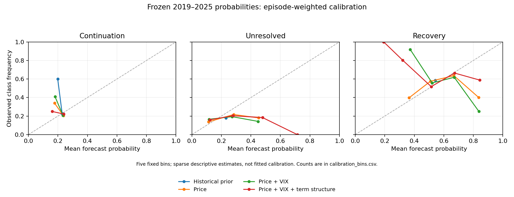

# Frozen recovery-model diagnostics

All inputs come from the original `4d19649` recovery snapshot. Forecasts, C values,
features, scaling, labels, thresholds and prior results remain unchanged. No model
was fitted, no calibrator was fitted, and no diagnostic winner was adopted.
Reproduce with `python -m src.analysis.recovery_diagnostics`.

These checks were requested after viewing the evaluation results. They diagnose
the existing experiment; they do not constitute a new untouched holdout or rescue
its primary result. On the frozen 2019–2025 evaluation, term-structure log loss
remains 1.017874 versus the historical prior's 0.977701. The previously reported
paired loss interval crosses zero. There is no established predictive improvement.

## 1. Why continuation never wins argmax

175 decline-trigger decisions represent 53 episodes. All probability summaries
use one total weight per episode. Unresolved outcomes stay in the analysis.

| model_id                     |   one_vs_rest_auc |   mean_probability |   observed_frequency |   argmax_recall |   margin_max |
|:-----------------------------|------------------:|-------------------:|---------------------:|----------------:|-------------:|
| class_prior                  |          0.380385 |           0.228178 |             0.233895 |        0.000000 |    -0.266188 |
| logit_price                  |          0.391295 |           0.224416 |             0.233895 |        0.000000 |    -0.185524 |
| logit_term_structure         |          0.474193 |           0.206441 |             0.233895 |        0.000000 |    -0.195858 |
| logit_term_structure_matched |          0.474193 |           0.206441 |             0.233895 |        0.000000 |    -0.195858 |
| logit_vix_level              |          0.346557 |           0.227311 |             0.233895 |        0.000000 |    -0.170184 |
| uniform                      |          0.500000 |           0.333333 |             0.233895 |        0.333333 |     0.000000 |

For the designated term-structure model, continuation AUC is 0.474193.
The largest continuation probability minus its strongest competitor is
-0.195858; a negative value means continuation never has the highest
probability. This is a statement about the unchanged argmax rule, not a claim
that continuation probabilities are zero. AUC is descriptive ranking performance;
these additional class-specific estimates have no confidence intervals.

The term-structure model's continuation probabilities, grouped by actual outcome:

| actual_class   |   n_triggers |   mean_probability |   min_probability |      p10 |   median |      p90 |   max_probability |
|:---------------|-------------:|-------------------:|------------------:|---------:|---------:|---------:|------------------:|
| continuation   |           54 |           0.202564 |          0.054727 | 0.131125 | 0.202524 | 0.257411 |          0.362978 |
| unresolved     |           29 |           0.186877 |          0.055513 | 0.120092 | 0.199238 | 0.247207 |          0.269585 |
| recovery       |           92 |           0.213950 |          0.039824 | 0.155082 | 0.223113 | 0.266636 |          0.307489 |

In this snapshot, continuation receives a slightly lower mean forecast on actual
continuations than on actual recoveries. Together with the AUC near 0.5, this
provides no convincing hidden continuation-ranking signal to recover merely by
changing the class decision rule. It does not prove that no signal exists.

Its confusion matrix below uses raw trigger counts (rows actual, columns
predicted). The CSV also provides episode-weighted masses and row-normalized
recalls. Exact ties split prediction mass evenly; missing actual classes yield
undefined recall. Neither thresholds nor probability order was changed.

| actual_class   |   continuation |   unresolved |   recovery |
|:---------------|---------------:|-------------:|-----------:|
| continuation   |          0.000 |        3.000 |     51.000 |
| unresolved     |          0.000 |        2.000 |     27.000 |
| recovery       |          0.000 |        6.000 |     86.000 |

## 2. Probability calibration

For the designated model:

| class_name   |   mean_probability |   observed_frequency |   forecast_minus_observed |   ece_fixed_bins |   populated_bins |
|:-------------|-------------------:|---------------------:|--------------------------:|-----------------:|-----------------:|
| continuation |           0.206441 |             0.233895 |                 -0.027454 |         0.047737 |                2 |
| unresolved   |           0.223134 |             0.179006 |                  0.044129 |         0.078622 |                4 |
| recovery     |           0.570425 |             0.587099 |                 -0.016675 |         0.039313 |                5 |

Positive forecast-minus-observed means aggregate overprediction; negative means
underprediction. This is the episode-weighted population, not raw trigger counts.
Global bias can hide offsetting errors in different probability bins.
In this snapshot the largest absolute aggregate class bias is overprediction of
unresolved outcomes. Recovery is slightly underpredicted in aggregate despite
being the most frequent argmax prediction; argmax counts and calibration answer
different questions.

Five fixed bins are [0,.2), [.2,.4), [.4,.6), [.6,.8), [.8,1]. The CSV retains
empty bins with undefined means and zero weight, and lists trigger/episode counts
for every bin. Weights are computed before binning and stay fixed. One episode
can span bins, so the bin episode counts are not additive. ECE is the weighted
absolute bin gap; it depends on the bins and is not a proper scoring rule or a
selection criterion. Sparse, dependent observations make these descriptive curves
uncertain. No statistically established miscalibration or superiority is claimed.

## 3. Validation sensitivity and saved coefficient stability

Only the original 32 completed validation triggers across ten episodes enter the
ranking sensitivity. Full-sample candidate losses and winners reproduce the
original selection. Below, each episode is omitted from SCORING in turn:

| feature_set    |         C |   n_omissions |   n_ranked_first |   best_rank |   worst_rank |   min_loss_minus_prior |   max_loss_minus_prior |
|:---------------|----------:|--------------:|-----------------:|------------:|-------------:|-----------------------:|-----------------------:|
| price          | 10.000000 |            10 |               10 |           1 |            1 |              -0.195297 |              -0.103937 |
| term_structure |  1.000000 |            10 |                7 |           1 |            2 |              -0.163731 |              -0.053270 |
| vix_level      |  1.000000 |            10 |                7 |           1 |            2 |              -0.152906 |              -0.041858 |

All candidate winner counts, including alternatives to the frozen C values:

| feature_set    |         C | originally_selected   |   n_ranked_first |
|:---------------|----------:|:----------------------|-----------------:|
| price          |  0.010000 | False                 |                0 |
| price          |  0.100000 | False                 |                0 |
| price          |  1.000000 | False                 |                0 |
| price          | 10.000000 | True                  |               10 |
| term_structure |  0.010000 | False                 |                0 |
| term_structure |  0.100000 | False                 |                3 |
| term_structure |  1.000000 | True                  |                7 |
| term_structure | 10.000000 | False                 |                0 |
| vix_level      |  0.010000 | False                 |                0 |
| vix_level      |  0.100000 | False                 |                2 |
| vix_level      |  1.000000 | True                  |                7 |
| vix_level      | 10.000000 | False                 |                1 |

This is not refitted cross-validation: an omitted validation episode may already
have entered training for later saved forecasts, and neighbouring label windows
can overlap. These are diagnostic rankings only. No C is changed, no grid is
expanded, and no evaluation outcome affects the ranks. Ten validation episodes
remain a very small design sample, even when a winner is stable to these omissions.
All three originally selected models retain lower validation loss than the prior
under every single-episode omission. Thus their validation advantage was not
entirely due to any one scored episode, but it still failed to carry over to the
primary evaluation. Price's unchanged C=10 is the upper edge of the original grid,
so its stable ranking within this grid does not establish a global optimum.

For the term-structure model, continuation-minus-recovery coefficient contrasts
over its saved 2019–2025 refits are:

| term      |   n_fits |     first |      last |       min |       max |   n_positive |   n_negative |   nonzero_sign_changes |
|:----------|---------:|----------:|----------:|----------:|----------:|-------------:|-------------:|-----------------------:|
| dec_dd    |      175 |  0.007806 |  0.003712 | -0.017274 |  0.400690 |          169 |            6 |                      4 |
| dec_mom   |      175 |  0.029079 |  0.107882 |  0.029079 |  0.309162 |          175 |            0 |                      0 |
| intercept |      175 | -1.043025 | -0.962805 | -1.099429 | -0.783848 |            0 |          175 |                      0 |
| ts_ratio  |      175 |  0.452556 |  0.083642 |  0.046865 |  0.804875 |          175 |            0 |                      0 |
| vix_log   |      175 | -0.594008 | -0.109160 | -0.594008 |  0.245281 |           11 |          164 |                      6 |

These contrasts parameterize log(p_continuation / p_recovery). Positive slope
means a larger scaled feature increases that ratio, holding the others fixed.
The full CSV includes all fitted models and unresolved-minus-recovery contrasts.
Sign changes skip values within 1e-10 of zero. The observations are successive
fitted states, not independent coefficient estimates or causal effects. The
training scaler and clipping limits change between refits, so cross-date magnitude
comparisons are approximate. Validation coefficients were not saved; none were
refitted or fabricated for this report.
The term-structure contrast is positive in all 175 saved fits, while the VIX-level
contrast changes sign six times. A stable fitted direction for term structure
does not establish incremental predictive value; the unchanged primary comparison
with the VIX-level model still provides no established advantage.

## Handoff implications

Keep the original log-loss comparison as the primary result. These diagnostics
can explain model weaknesses; they cannot restore an untouched holdout or create
more independent decline episodes. A calibration plot or a favourable class AUC
does not establish profitable timing. Keep both prior and simple price baselines.

Member 4 should consume the original signal loaders, keep models frozen, define
allocation on design data, and explicitly handle non-decline dates, next-close
execution, initial trading costs, turnover and drifted weights. Probabilities are
not portfolio weights. Files in this diagnostics folder contain future outcomes
or retrospective summaries and must not be used as live trading inputs.

See `docs/recovery_diagnostics_protocol.md` for definitions and limitations,
`reports/recovery_evaluation/report.md` for the unchanged primary evaluation, and
`docs/model_extensions.md` for signal-loading examples. The manifest verifies
original input hashes, records analysis sources and hashes every output.
